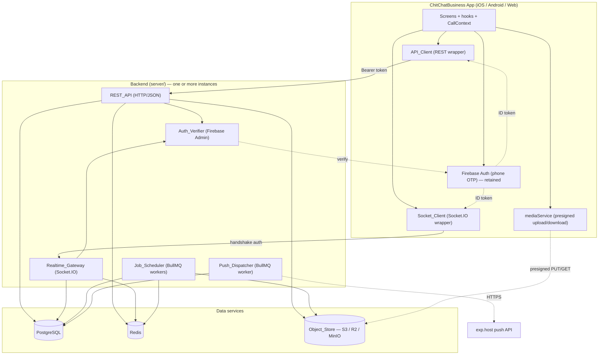
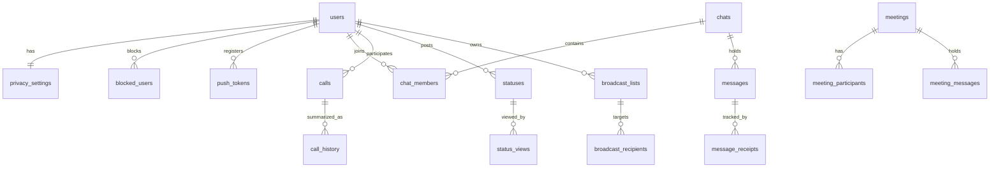
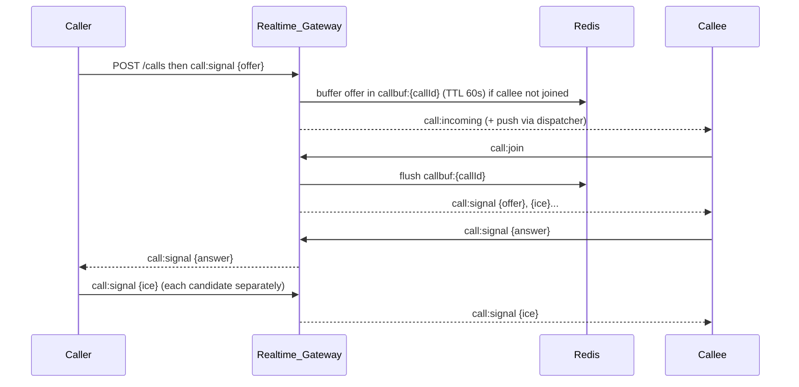

# Design Document

## Introduction

This design describes how ChitChatBusiness migrates off Firebase for everything except phone-OTP authentication. Firebase Auth stays as the identity provider; Firestore, Firebase Storage and Cloud Functions are replaced by a new Node.js + TypeScript backend (`server/`) backed by PostgreSQL, Redis, Socket.IO (with the Redis adapter) and an S3-compatible object store accessed through presigned URLs.

The design covers the backend project layout and stack, the Postgres schema, Redis key layout, the REST and Socket.IO contracts, the app-side `API_Client`/`Socket_Client` layer, how each Firestore-backed hook maps to the new layer, the WebRTC signaling transport swap, the push dispatcher and cleanup jobs, security and testing, and the Slice 0–8 cutover plan. It is written against the requirements in `requirements.md` (Requirements 1–14) and the current codebase.

### Expo SDK version note

`package.json` declares Expo SDK `~57` (`expo ^57.0.23`, React Native `0.86.3`), while `AGENTS.md` instructs reading the Expo `v56.0.0` versioned docs. The v56 reference maps SDK 56 to React Native 0.85. This is a real mismatch. Per `AGENTS.md`, implementers read the versioned Expo docs at `https://docs.expo.dev/versions/v56.0.0/` before writing or changing app code, and confirm each API against the installed SDK. One concrete consequence for this feature: the SDK 56 `expo-file-system` reference uses the `File`/`Directory`/`Paths` API (not the legacy `FileSystem.uploadAsync` namespace). The app-side media upload (Requirement 10) must be written against the API actually present in the installed `expo-file-system`, verified at implementation time. No app-side code in this feature is written without first checking the versioned docs for the API in use.

## Architecture

### System context



The App never talks to Postgres, Redis or the Object_Store directly. Media bytes flow App ⇄ Object_Store over presigned URLs; everything else flows through the REST_API or the Realtime_Gateway. Firebase Auth is the only Firebase service the App still uses, and the backend only uses the Firebase Admin SDK to verify ID tokens.

### Request / realtime flow

```mermaid
sequenceDiagram
  participant App
  participant FA as Firebase Auth
  participant REST as REST_API
  participant GW as Realtime_Gateway
  participant PG as Postgres
  participant RD as Redis

  App->>FA: ensure fresh ID token (refresh if <5 min to expiry)
  App->>REST: POST /chats/:id/messages (Bearer token, clientId)
  REST->>REST: Auth_Verifier resolves uid
  REST->>PG: upsert user; insert message (expires_at = now + 72h)
  REST-->>App: 201 stored message
  REST->>RD: enqueue push job + emit via Socket.IO Redis adapter
  GW-->>App: new-message event to other chat members
  App->>GW: message:delivered ack
  GW->>PG: record delivered; emit delivery update to sender
```

### Backend stack choices

| Concern | Choice | Rationale |
| --- | --- | --- |
| Language / runtime | Node.js (LTS) + TypeScript, ESM | Matches the existing `functions/` TS code and the app language; one language across the stack. |
| REST framework | Fastify | First-class JSON schema validation, structured logging (pino) with request IDs (Req 1.10), fast, good TypeScript support. |
| Realtime | Socket.IO + `@socket.io/redis-adapter` | Requirement names Socket.IO and the Redis adapter directly (Req 5.16); cross-instance fan-out for free. |
| Postgres access | `pg` driver + a thin typed query layer; `node-pg-migrate` for migrations | Parameterized queries by default (Req 12.2); ordered, idempotent migrations (Req 1.6, 1.7). |
| Validation | zod | Shared request/response and socket payload schemas (Req 12.1); types inferred from schemas. |
| Jobs / scheduling | BullMQ on Redis | Repeatable jobs for cleanup (Req 11), retriable push and object-deletion jobs; single-run guarantee across instances via Redis locks (Req 11.4). |
| Auth | `firebase-admin` | Verify Firebase ID tokens for REST and sockets (Req 2.4, 2.8). |
| Object store | AWS SDK v3 S3 client + `@aws-sdk/s3-request-presigner` | S3-compatible; one client works against S3, R2 and MinIO by endpoint config (Req 10, 1.2). |
| Logging | pino (JSON) | Structured logs with request IDs and redaction (Req 1.10, 12.6). |
| Tests | Vitest (or Jest) + Supertest + `socket.io-client` | Integration tests against Dev_Stack Postgres + Redis (Req 12.8). |

### Backend project layout

```
server/
  package.json
  tsconfig.json
  .env.example                 # every required env var with placeholders (Req 1.4)
  vitest.config.ts
  migrations/                  # ordered SQL migrations (Req 1.6)
    1700000000000_init.sql
    ...
  src/
    index.ts                   # bootstrap: validate env, start REST + GW, register shutdown
    config/
      env.ts                   # zod-validated env; exits non-zero naming the missing var (Req 1.5)
      logger.ts                # pino with redaction (Req 12.6)
    db/
      pool.ts                  # pg Pool
      migrate.ts               # runs node-pg-migrate (Req 1.6, 1.7)
      repositories/            # users, chats, messages, calls, meetings, statuses, broadcasts, media, pushTokens, privacy, blocks
    redis/
      client.ts                # ioredis connections (pub, sub, general)
      keys.ts                  # key builders (see Redis key design)
    auth/
      verifier.ts              # Auth_Verifier (Req 2.4, 2.5)
      firebaseAdmin.ts
    http/
      server.ts                # Fastify app, CORS, rate-limit, request-id, /health
      middleware/              # auth, rateLimit, errorHandler
      routes/                  # health, me, users, contacts, pushTokens, privacy, blocks,
                               # chats, messages, calls, meetings, statuses, broadcasts, media
    realtime/
      gateway.ts               # Socket.IO server + Redis adapter + handshake auth (Req 2.7, 5.16)
      handlers/                # chat, presence, typing, signaling, meeting, status
      presence.ts              # Redis presence/typing (Req 7)
    media/
      presign.ts               # upload/download presigned URLs, prefix auth (Req 10)
    push/
      dispatcher.ts            # Expo push worker (Req 6)
    jobs/
      scheduler.ts             # BullMQ repeatable jobs (Req 11)
      cleanupStatuses.ts
      cleanupMessages.ts
      cleanupStaleCalls.ts
      deleteObject.ts          # retriable object deletion (Req 10.11)
    domain/
      schemas/                 # zod schemas shared by REST + sockets
      visibility.ts            # privacy + block evaluation (Req 4.13, 7, 9)
    test/                      # integration + unit tests (Req 12.8)
docker-compose.yml             # repo root: Postgres + Redis + MinIO (Req 1.2)
```

### App-side layout (new modules)

```
src/
  api/
    client.ts        # API_Client: fetch wrapper, Bearer token, typed results/errors (Req 2.2, 3.4, 3.5)
    endpoints.ts     # typed REST method surface
    errors.ts        # ApiError (HTTP + backend code) vs NetworkError (Req 3.4, 3.5)
  realtime/
    socket.ts        # Socket_Client: connect, handshake auth, backoff, re-join, subscribe (Req 3.6-3.8, 2.7-2.9)
  services/
    mediaService.ts  # presigned upload/download; replaces src/config/storage.ts (Req 10.9)
  config/
    featureFlags.ts  # per-feature Backend-vs-Firebase selection (Req 3.9)
    env.ts           # reads EXPO_PUBLIC_API_URL / EXPO_PUBLIC_SOCKET_URL; errors if missing (Req 3.2, 3.3)
```

## Components and Interfaces

### Auth_Verifier (Req 2.4, 2.5, 2.6, 2.11)

Verifies the `Authorization: Bearer <idToken>` header (REST) or `socket.handshake.auth.token` (sockets) with `firebase-admin` `verifyIdToken`. On success it resolves `{ firebaseUid, phoneNumber }`, upserts the user row keyed by `firebase_uid` on first contact (Req 2.6), and attaches the resolved identity to the request/socket. On a missing, malformed, expired or revoked token it returns HTTP 401 (REST) or rejects the socket connection (sockets) with a machine-readable `code` such as `AUTH_TOKEN_INVALID` / `AUTH_TOKEN_EXPIRED` (Req 2.5, 2.8). Every handler authorizes against this resolved uid and ignores any user ID in the request body (Req 2.11).

```ts
interface AuthedIdentity { userId: string; firebaseUid: string; phoneNumber: string | null; }
async function verifyToken(token: string): Promise<AuthedIdentity>; // throws AuthError -> 401
```

### REST_API endpoint list

All routes require a verified identity except `GET /health`. All list endpoints that page use opaque cursors and exclude rows past `expires_at` (Req 11.7). Standard error body: `{ error: { code: string, message: string, details?: unknown } }`.

| Method & path | Purpose | Requirements |
| --- | --- | --- |
| `GET /health` | 200 when Postgres + Redis respond; 503 naming the failing dependency | 1.8, 1.9 |
| `GET /me` | Current user profile | 4.2 |
| `PATCH /me` | Update profile (display name, about, avatar key) | 4.3 |
| `PUT /me/phone` | Update phone after Firebase number change; 409 if taken | 4.6 |
| `GET /me/privacy` | Read own Privacy_Settings | 4.9 |
| `PUT /me/privacy` | Update Privacy_Settings | 4.10 |
| `POST /contacts/match` | Match phone numbers → registered users (privacy-filtered); 413 if >500 | 4.4, 4.5 |
| `GET /blocks` | List blocked users | 4.12 |
| `POST /blocks` / `DELETE /blocks/:userId` | Block / unblock | 4.11 |
| `POST /push-tokens` / `DELETE /push-tokens/:token` | Register / remove Expo push token | 4.7, 4.8 |
| `GET /chats` | Chat list with last message, per-chat + total unread | 5.11 |
| `POST /chats` | Create direct or group chat (creator = admin) | 5.1, 5.12 |
| `PATCH /chats/:id` | Edit group metadata/members (admin only) | 5.13 |
| `GET /chats/:id/messages?cursor=&limit=50` | Messages, descending, cursor paginated | 5.9 |
| `GET /chats/:id/messages?after=<messageId>` | Messages newer than last received (reconnect) | 5.18 |
| `POST /chats/:id/messages` | Send message (idempotent on `clientId`) | 5.3, 5.17 |
| `POST /chats/:id/messages/:mid/delete` | Delete for me / everyone | 5.14 |
| `POST /messages/forward` | Forward one message to N chats | 5.15 |
| `POST /calls` | Create call record | 8.4 |
| `GET /calls/history?cursor=` | Call history + missed, descending, paginated | 8.11 |
| `DELETE /calls/history` | Clear call history | 8.12 |
| `POST /meetings` / `GET /meetings/:id` | Create / fetch meeting | 8.14 |
| `GET /statuses` | Unexpired, visibility-filtered statuses + unviewed indicators | 9.2, 9.4 |
| `POST /statuses` | Post a status (`expires_at = now + 24h`) | 9.1 |
| `POST /statuses/:id/view` | Record a view | 9.3 |
| `DELETE /statuses/:id` | Delete status + request media deletion | 9.5 |
| `GET /broadcasts` / `POST /broadcasts` / `PATCH`/`DELETE` | Broadcast list CRUD (owner-scoped) | 9.6 |
| `POST /broadcasts/:id/send` | Fan out to recipients' direct chats (skip blockers) | 9.7, 9.8 |
| `POST /media/upload-url` | Presigned upload URL + Object_Key + expiry (prefix-authorized, size/type checked) | 10.1–10.5 |
| `POST /media/download-url` | Presigned download URL(s) for authorized keys | 10.6 |

### Socket.IO event contract

Handshake: `io(SOCKET_URL, { auth: { token } })`. The gateway verifies the token (Req 2.8). Rooms: `user:{userId}` (always joined), `chat:{chatId}` (per membership), `call:{callId}`, `meeting:{meetingId}`.

Client → Server events (ack-based where state changes):

| Event | Payload | Server behavior | Requirements |
| --- | --- | --- | --- |
| `chat:join` / `chat:leave` | `{ chatId }` | Join/leave `chat:{chatId}` after membership check | 5.5 |
| `message:delivered` | `{ chatId, messageId }` | Record recipient delivered; emit `message:delivered` to sender room | 5.6 |
| `message:read` | `{ chatId, messageId[] }` | Record read; emit `message:read` to sender unless reader disabled read receipts | 5.7, 5.8 |
| `typing:start` / `typing:stop` | `{ chatId }` | Set/clear Redis typing key (TTL 5s); relay to chat room (block-filtered) | 7.6, 7.7, 7.9 |
| `presence:ping` | — | Refresh presence key (TTL 60s) | 7.1, 7.2 |
| `call:signal` | `{ callId, kind: 'offer'\|'answer'\|'ice'\|'accept'\|'reject'\|'end'\|'state', data }` | Relay to the other participant; buffer offer/ice in Redis if callee not joined; reject non-participants | 8.1, 8.2, 8.7, 8.8 |
| `call:join` / `call:leave` | `{ callId }` | Join/leave call room; flush buffered signals on join | 8.8 |
| `meeting:join` / `meeting:leave` | `{ meetingId }` | Join/leave; emit participant change to room | 8.15 |
| `meeting:message` | `{ meetingId, ... }` | Persist + deliver to meeting room | 8.16 |
| `meeting:signal` | `{ meetingId, ... }` | Relay meeting signaling to participants | 8.17 |

Server → Client events: `message:new`, `message:delivered`, `message:read`, `message:deleted`, `chat:updated`, `typing`, `presence`, `status:update`, `status:viewed`, `call:incoming`, `call:signal`, `call:missed`, `meeting:participants`, `meeting:message`, `meeting:signal`. Every emit that targets another user is filtered through block and Privacy_Settings rules before leaving the server (Req 4.13, 5.4, 7.4, 7.5, 7.9).

### API_Client (Req 2.2, 2.3, 3.4, 3.5)

A `fetch` wrapper that: reads the base URL from `EXPO_PUBLIC_API_URL`; before each request obtains a fresh Firebase ID token, refreshing it when within 5 minutes of expiry or already expired (Req 2.3); sets `Authorization: Bearer`; returns a discriminated result. HTTP failures resolve to `ApiError { status, code }`; absence of connectivity (checked via `@react-native-community/netinfo`, already a dependency) rejects with a distinct `NetworkError` (Req 3.5).

```ts
type ApiResult<T> = { ok: true; data: T } | { ok: false; error: ApiError | NetworkError };
```

### Socket_Client (Req 2.7–2.10, 3.6–3.8)

Wraps a single Socket.IO connection: attaches the fresh ID token to the handshake; reconnects with exponential backoff (Req 3.6); on reconnect re-joins the rooms for active chats, the active call and any open meeting (Req 3.7) and triggers an `after=<lastMessageId>` fetch per active chat (Req 5.18); reconnects with a refreshed token when the current token expires (Req 2.9); exposes `subscribe(event, handler): () => void` so hooks detach on unmount (Req 3.8); disconnects and clears cached state on sign-out (Req 2.10).

### mediaService (Req 10.1, 10.6, 10.8, 10.9)

Replaces `src/config/storage.ts`. `getUploadUrl(category, params)` → calls `POST /media/upload-url`, receives `{ uploadUrl, objectKey, expiresAt }`, uploads bytes directly to the Object_Store with the presigned URL (no bytes through the backend, Req 10.8), and returns the `objectKey` for storage in a message/status/profile. `getDownloadUrl(objectKey)` → `POST /media/download-url`. The recording upload in `VideoCallScreen.tsx` is rewired to this service (Req 10.9).

## Data Models

### Postgres schema

Keys use `text` Firebase UIDs for `users.id` to match the identity model. All timestamps are `timestamptz`. All FKs cascade where child rows are meaningless without the parent.



Core tables (abbreviated column lists; every table has a surrogate PK unless noted):

- **users** — `id text PK (firebase_uid)`, `phone_number text UNIQUE`, `display_name text`, `about text`, `avatar_object_key text`, `last_seen timestamptz`, `created_at`. (Req 2.6, 4.1, 7.3)
- **privacy_settings** — `user_id text PK FK→users`, `last_seen`, `profile_photo`, `status_visibility`, `groups`, `calls` (enum `everyone|contacts|nobody`), `read_receipts bool`, `disappearing_messages bool`. Mirrors `usePrivacySettings`. (Req 4.9, 4.10)
- **blocked_users** — `(blocker_id, blocked_id)` PK, both FK→users. (Req 4.11, 4.13)
- **push_tokens** — `(user_id, token)` PK, `platform`, `created_at`. (Req 4.7, 4.8, 6.4)
- **chats** — `id uuid PK`, `type enum('direct','group')`, `group_name`, `group_photo_object_key`, `created_by FK→users`, `created_at`, `direct_key text UNIQUE NULL` (sorted member pair for direct chats to dedupe, mirroring `getOrCreateDirectChat`). (Req 5.1, 5.12)
- **chat_members** — `(chat_id, user_id)` PK, `role enum('admin','member')`, `unread_count int default 0`, `joined_at`, `last_read_message_id NULL`. (Req 5.1, 5.11, 5.13)
- **messages** — `id uuid PK`, `chat_id FK`, `sender_id FK`, `client_id text` (UNIQUE per `(chat_id, sender_id)` for idempotency, Req 5.17), `type enum('text','image','voice','video','file','location','system','catalog')` (Req 5.2), `text`, `media_object_key`, `thumbnail_object_key`, `file_name`, `file_size`, `mime_type`, `duration_ms`, `location jsonb`, `catalog_item jsonb`, `subtype`, `created_at`, `expires_at` (`= created_at + 72h`, Req 5.3), `deleted_for_everyone bool`, `deleted_for jsonb` (array of user ids). (Req 5.1–5.3)
- **message_receipts** — `(message_id, user_id)` PK, `delivered_at NULL`, `read_at NULL`, `blocked_message bool`. Replaces Firestore `deliveredTo`/`readBy` arrays and the per-recipient `blockedMessage` flag; unread counts and push exclusion read from here (Req 5.6, 5.7, 5.10, 6.3).
- **calls** — `id text PK` (keeps `${caller}_${callee}_${ts}` scheme), `caller_id`, `callee_id`, `participants jsonb`, `type enum('audio','video')`, `state`, `start_time`, `end_time`, `duration_sec`, `created_at`, `updated_at`. Offer/answer/ICE are **not** stored here — they are relayed as events and only briefly buffered in Redis (Req 8.1, 8.2, 8.4, 8.8). (Replaces the Firestore `calls` doc with its `offer/answer/*IceCandidates` fields.)
- **call_history** — `(user_id, call_id)` PK, `other_party jsonb`, `type`, `direction enum('incoming','outgoing')`, `status enum('completed','missed','rejected','busy','failed')`, `duration_sec`, `created_at`. (Req 8.9, 8.10, 8.11)
- **meetings** — `id uuid PK`, `title`, `organizer_id`, `is_active bool`, `ended_at`, `minutes text`, `minutes_generated_at`, `created_at`. (Req 8.14)
- **meeting_participants** — `(meeting_id, user_id)` PK, `role`, `is_muted bool`, `is_kicked bool`, `joined bool`, `joined_at`. (Req 8.14, 8.15)
- **meeting_messages** — `id uuid PK`, `meeting_id FK`, `sender_id`, `text`, `media_object_key`, `created_at`. (Req 8.16)
- **statuses** — `id uuid PK`, `user_id FK`, `media_object_key`, `thumbnail_object_key`, `media_type enum('image','video','text')`, `caption`, `background_color`, `text_color`, `duration_ms`, `visibility enum('everyone','contacts','except','only')`, `created_at`, `expires_at` (`= created_at + 24h`, Req 9.1). (Req 9.1, 9.2)
- **status_visibility_users** — `(status_id, user_id, mode)` where `mode enum('except','only')` for the excluded/selected lists. (Req 9.1, 9.2)
- **status_views** — `(status_id, viewer_id)` PK, `viewed_at`. (Req 9.3, 9.4)
- **broadcast_lists** — `id uuid PK`, `owner_id FK`, `name`, `created_at`, `last_sent_at`, `last_message`. (Req 9.6)
- **broadcast_recipients** — `(list_id, user_id)` PK. (Req 9.6)
- **media_objects** — `object_key text PK`, `owner_id`, `category`, `content_type`, `size_bytes`, `referenced_by` (nullable pointer to the owning message/status/avatar), `created_at`. Supports object-deletion-on-delete and cleanup (Req 10.7, 10.10).
- **migrations** — managed by `node-pg-migrate`; records applied migrations for idempotency (Req 1.7).

Indexes: `messages(chat_id, created_at desc)`, `messages(expires_at)`, `statuses(expires_at)`, `calls(updated_at)`, `call_history(user_id, created_at desc)`, `chat_members(user_id)`, partial unique on `messages(chat_id, sender_id, client_id)`.

### Redis key design

| Key | Type / TTL | Purpose | Requirements |
| --- | --- | --- | --- |
| `presence:{userId}` | string, TTL 60s, refreshed ≤30s | Online presence; expiry marks offline on crash | 7.1, 7.2, 7.10 |
| `presence:{userId}:sockets` | set | Count open sockets to detect first-connect / last-disconnect | 7.1, 7.3 |
| `typing:{chatId}:{userId}` | string, TTL 5s | Typing indicator | 7.7, 7.8 |
| `callbuf:{callId}` | list, TTL 60s | Buffered offer + ICE for a callee not yet joined | 8.8 |
| `ratelimit:{userId}:{action}` | counter + TTL (sliding window) | Per-user limits on send, media-url, contact-match | 12.3, 12.4 |
| `bull:*` | BullMQ-managed | Push, cleanup and object-deletion queues; repeatable-job locks | 6, 11.4 |
| Socket.IO adapter channels | pub/sub | Cross-instance event fan-out | 5.16 |

### App-side types

Existing types in `src/types/` are largely reused. The key change is that media fields that were download URLs (`imageUrl`, `voiceUrl`, `mediaUrl`, …) become Object_Keys resolved to short-lived download URLs via `mediaService` at render time (Req 10.6, 10.7). `ChatMessage` gains delivered/read state sourced from `message_receipts`. The `Call` type's `offer/answer/*IceCandidates` fields move out of persisted state and are carried only on `call:signal` events.

## Mapping legacy Firestore hooks to the new layer

| Legacy (Firestore/Storage/Functions) | New path | Slice |
| --- | --- | --- |
| `src/config/firebase.ts` (`db`, `storage`) | `API_Client` + `Socket_Client` + `mediaService`; `firebase.ts` keeps only `auth` after Slice 8 | 0, 8 |
| `src/config/storage.ts` `uploadFile`/`deleteFile` | `mediaService.getUploadUrl`/`getDownloadUrl`; backend deletes objects | 6 |
| `useChatActions.ts` (`getOrCreateDirectChat`, `sendMessage`, `send*Message`, `sendBroadcastMessage`, `markChatAsRead`) | `POST /chats`, `POST /chats/:id/messages`, `POST /broadcasts/:id/send`; receipts over sockets | 2, 5 |
| `useChats.ts` / `useMessages.ts` / `useLocalMessages.ts` (onSnapshot) | `GET /chats`, `GET /chats/:id/messages`, `message:new`/`message:read`/`message:deleted` subscriptions | 2 |
| `useUnreadCount.ts` | `chat_members.unread_count` via `GET /chats` + socket updates | 2 |
| `usePrivacySettings.ts` | `GET/PUT /me/privacy` | 1 |
| `useBlockedContacts.ts` / `BlockedContext.tsx` | `GET/POST/DELETE /blocks` | 1 |
| `useContacts.ts` / `usePhoneBook.ts` | `POST /contacts/match` | 1 |
| `useRegistration.ts` | `GET /me` upsert + `PATCH /me` + `POST /push-tokens` | 1 |
| `usePushNotifications.ts` | `POST/DELETE /push-tokens`; delivery by Push_Dispatcher | 1, 2 |
| `usePresence.ts` / `useLastSeen.ts` | `presence:ping` + `presence` events; `GET /me`/user last_seen | 3 |
| `useTypingIndicator.ts` | `typing:start/stop` + `typing` events | 3 |
| `signalingService.ts` (Firestore `arrayUnion` ICE) | `call:signal` events; `POST /calls`; `call:incoming`/`call:missed` | 4 |
| `useIncomingCalls.ts` / `useOutgoingCall.ts` / `useCallHistory.ts` / `useMissedCalls.ts` | `call:*` events + `GET /calls/history`, `DELETE /calls/history` | 4 |
| `useMeetingRoom.ts` | `POST/GET /meetings` + `meeting:*` events | 4 |
| `useStatus.ts` / `useUnviewedStatus.ts` | `GET/POST/DELETE /statuses`, `POST /statuses/:id/view`, `status:update`/`status:viewed` | 5 |
| `useBroadcastLists.ts` | `GET/POST/PATCH/DELETE /broadcasts`, `POST /broadcasts/:id/send` | 5 |
| `functions/src/index.ts` `onMessageCreated` | Push_Dispatcher BullMQ worker | 2 |
| `functions/src/index.ts` cleanup* | Job_Scheduler repeatable jobs | 7 |
| `src/services/statusCleanupService.ts` | server-side status cleanup job | 7 |

### WebRTC signaling transport swap (Req 8.1–8.3)

`CallContext`, `AudioCallScreen`, `VideoCallScreen`, `FloatingCallManager`, `useWebRTC` and the peer-connection logic are unchanged. Only `src/services/signalingService.ts` changes: instead of writing to a Firestore `calls` doc and appending ICE via `arrayUnion`, each method emits a `call:signal` event through `Socket_Client` and subscribes to inbound `call:signal` events, invoking the same callbacks the UI already consumes (`onCallUpdated`-style). Each ICE candidate is sent as its own event (Req 8.2). The method surface (`createCall`, `saveOffer`, `saveAnswer`, `addIceCandidate`, `updateCallStatus`, `onCallUpdated`, `getCall`, `saveToCallHistory`) is preserved so callers do not change; `createCall`/`saveToCallHistory` go through REST (`POST /calls`, call_history), the rest through sockets.



### Push_Dispatcher (Req 6)

A BullMQ worker triggered when a message is persisted (job enqueued inside the send handler, run off the request path, Req 6.6). For each chat member other than the sender it loads push tokens, skips recipients who blocked the sender or whose receipt is `blocked_message` (Req 6.3), skips recipients with an open authenticated socket joined to the chat room (checked via presence/room membership, Req 6.7), sends to `exp.host` with category `chat_message` and data `{ chatId, senderId, type: "message" }` (Req 6.2), deletes tokens reported `DeviceNotRegistered` (Req 6.4), and retries retryable failures up to 3 times with backoff (Req 6.5). The same dispatcher sends the incoming-call notification (Req 8.5).

### Job_Scheduler (Req 11)

BullMQ repeatable jobs with Redis-backed single-run locks (Req 11.4): expired-status cleanup hourly (Req 11.1), expired-message cleanup daily (Req 11.2), stale-call cleanup every 30 min using Stale_Call_Threshold = 3h (Req 11.3). Each job deletes the rows and enqueues `deleteObject` jobs for their Object_Keys; `deleteObject` retries up to 3 times and logs the key on persistent failure (Req 10.11, 11.5). Each run logs deleted row and object counts (Req 11.6). All read paths independently exclude rows past `expires_at` (Req 11.7).

## Error Handling

- **Env/startup**: `config/env.ts` validates with zod; a missing variable causes a non-zero exit naming the variable (Req 1.5).
- **Auth**: invalid/expired/revoked tokens → 401 with a code (Req 2.5); socket handshake rejection (Req 2.8).
- **Authorization**: non-members and non-participants → authorization error on REST and sockets (Req 5.5, 8.7); writes under unpermitted media prefixes → authorization error (Req 10.3).
- **Validation**: zod rejects bad REST bodies/queries with 400 and bad socket payloads with an error ack (Req 12.1); oversized contact lists → 413 (Req 4.5); oversized/wrong-type media → 400 (Req 10.5); duplicate phone → 409 (Req 4.6); duplicate `client_id` returns the stored message (Req 5.17).
- **Rate limits**: 429 with `Retry-After` (Req 12.4).
- **Health**: 503 naming the failing dependency (Req 1.9).
- **Network (app)**: `NetworkError` distinct from `ApiError` (Req 3.5).
- **Shutdown**: SIGTERM stops accepting connections, drains in-flight work and closes Postgres/Redis/sockets within 15s (Req 12.7).
- **Logging**: JSON logs with request IDs (Req 1.10); Firebase ID tokens, push tokens and presigned URLs redacted (Req 12.6).

## Security

Parameterized Postgres queries everywhere (Req 12.2); per-user Redis rate limits on send/media/contact-match (Req 12.3); configured CORS and Socket.IO origin allow-lists (Req 12.5); server-side block enforcement for messaging, calling and presence (Req 4.13); upload prefixes constrained to `avatars/{userId}/`, `chats/{chatId}/media/`, `chats/{chatId}/voice/`, `groups/{chatId}/`, `status/{userId}/`, `meetings/{meetingId}/` with per-user authorization (Req 10.2, 10.3); upload URLs expire within 15 minutes (Req 10.4); documentation states TLS termination is required in front of the backend for any non-local deployment (Req 12.9).

## Testing Strategy

Integration tests run against Dev_Stack Postgres + Redis (Req 12.8) covering authentication, authorization, message delivery and cleanup jobs. Property-based tests (fast-check, already a dev dependency) cover pure, input-varying logic: visibility/block evaluation, cursor pagination, idempotent message insert, TTL computation and the media prefix authorizer. Example/integration tests cover one-shot and I/O behaviors (health, push dispatch with a mocked `exp.host`, presigned-URL issuance against MinIO, socket relay). App-side tests mock `API_Client`/`Socket_Client` (Req 14.8). Each property test is tagged `Feature: firebase-to-sockets-redis-postgres-migration, Property N: <text>` and runs ≥100 iterations.

## Correctness Properties

*A property is a characteristic or behavior that should hold true across all valid executions of a system — a formal statement about what the system should do. Properties bridge human-readable specifications and machine-verifiable correctness guarantees.*

The following properties were derived from the acceptance criteria. Timing, infrastructure-wiring, UI and documentation criteria are validated by integration, example and edge-case tests instead and are not restated as universal properties.

### Property 1: Message and status TTL

For any message created at time `t`, its `expires_at` equals `t + 72 hours`; for any status created at time `t`, its `expires_at` equals `t + 24 hours`.

**Validates: Requirements 5.3, 9.1**

### Property 2: Expired rows are never returned by read paths

For any set of messages or statuses with mixed expiry times, no row whose `expires_at` is at or before the current time appears in any REST or realtime read result, regardless of whether a cleanup job has run.

**Validates: Requirements 11.7**

### Property 3: Cursor pagination is complete and ordered

For any set of messages in a chat (and likewise for any user's call history), paging through all cursor pages returns every row exactly once in descending creation order with no page exceeding its configured size (50 for messages).

**Validates: Requirements 5.9, 8.11**

### Property 4: Message send is idempotent on client id

For any chat message submitted twice with the same client-generated id, exactly one message row exists afterward and both responses return the originally stored message.

**Validates: Requirements 5.17**

### Property 5: Chat membership gates message access

For any user who is not a member of a chat, every message read and write operation for that chat is rejected with an authorization error on both the REST_API and the Realtime_Gateway.

**Validates: Requirements 5.5**

### Property 6: Authorization uses the verified identity

For any request whose body supplies a user id different from the id resolved from the verified token, the operation applies only to the token-resolved user and never to the body-supplied id.

**Validates: Requirements 2.11**

### Property 7: Block isolation across messaging, presence, typing and calls

For any ordered pair of users where the recipient has blocked the sender, no new-message, presence, typing, status, or incoming-call event originating from the sender is delivered to the blocking recipient, and a call initiated by a blocked caller is rejected without notifying the callee.

**Validates: Requirements 4.13, 5.4, 7.9, 8.6**

### Property 8: Blocked messages are excluded from unread counts and push

For any message marked `blocked_message` for a recipient, that message is excluded from the recipient's per-chat and total unread counts and generates no push notification to that recipient.

**Validates: Requirements 5.10, 6.3**

### Property 9: Delivered and read receipts are recorded on acknowledgment

For any recipient and message, a delivered acknowledgment sets that recipient's `delivered_at` and a read acknowledgment sets that recipient's `read_at`.

**Validates: Requirements 5.6, 5.7**

### Property 10: Read receipts respect the reader's privacy setting

For any read acknowledgment, the recipient's read state is recorded, and a read event is emitted to the sender if and only if the reader has read receipts enabled.

**Validates: Requirements 5.8**

### Property 11: Unread counts match outstanding receipts

For any chat and user, the reported per-chat unread count equals the number of that user's non-blocked, unread messages in the chat, and the reported total unread count equals the sum of per-chat unread counts.

**Validates: Requirements 5.11**

### Property 12: Push recipient set

For any message, the set of recipients the Push_Dispatcher notifies equals the chat members minus the sender, minus recipients who blocked the sender, minus recipients with `blocked_message` for that message, minus recipients with an open authenticated socket joined to the chat room.

**Validates: Requirements 6.1, 6.3, 6.7**

### Property 13: Contact matching returns only matching, privacy-permitted data

For any submitted list of phone numbers and any set of registered users, every returned user has a phone number present in the submitted list and exposes only the fields permitted by that matched user's Privacy_Settings.

**Validates: Requirements 4.4**

### Property 14: Presence and last-seen honor privacy

For any user whose Privacy_Settings hide online presence or last seen, that information is omitted from every REST response and realtime event sent to a viewer not permitted to see it.

**Validates: Requirements 7.4, 7.5**

### Property 15: Status visibility is enforced

For any viewer and any set of statuses, every returned status is unexpired and permitted for that viewer under its visibility mode (`everyone`, `contacts`, `except`, `only`) and the owner's Privacy_Settings, and no disallowed status is returned.

**Validates: Requirements 9.2**

### Property 16: Broadcast sends one message per non-blocking recipient

For any broadcast with a recipient set, the send creates exactly one message in the direct chat with each recipient that has not blocked the sender, skips each recipient that has blocked the sender, and returns success for the remaining recipients regardless of any skipped recipient.

**Validates: Requirements 9.7, 9.8**

### Property 17: Each ICE candidate is relayed as its own event

For any list of ICE candidates produced during a call, the Realtime_Gateway relays exactly one `call:signal` ICE event per candidate to the other participant.

**Validates: Requirements 8.2**

### Property 18: Only call participants may signal

For any signaling event sent by a user who is not a participant of the referenced call, the Realtime_Gateway discards the event and returns an authorization error to the sender.

**Validates: Requirements 8.7**

### Property 19: Buffered signals are delivered on join

For any offer and ICE candidates buffered while the callee is not yet joined, when the callee joins the call room within the 60-second window the callee receives exactly the set of buffered signals.

**Validates: Requirements 8.8**

### Property 20: Media keys use authorized prefixes

For any authenticated user and media category, an issued Object_Key uses the prefix defined for that category (`avatars/{userId}/`, `chats/{chatId}/media/`, `chats/{chatId}/voice/`, `groups/{chatId}/`, `status/{userId}/`, `meetings/{meetingId}/`), and a request to write under a prefix the user is not permitted to use is refused with an authorization error.

**Validates: Requirements 10.2, 10.3**

### Property 21: Upload URLs are short-lived

For any issued upload Presigned_URL, its expiry is at most 15 minutes after issuance.

**Validates: Requirements 10.1, 10.4**

### Property 22: Stored media references are object keys, not URLs

For any stored message, status, avatar or recording that references media, the persisted value is an Object_Key and not a download URL.

**Validates: Requirements 10.7**

### Property 23: Invalid input is rejected

For any REST request body or query, or any Socket.IO event payload, that fails its schema, the Backend rejects it with HTTP 400 (REST) or an error acknowledgment (socket) and performs no state change.

**Validates: Requirements 12.1**

### Property 24: Rate-limited requests return 429 with Retry-After

For any stream of a rate-limited action by a single user that exceeds the configured window, every request beyond the limit receives HTTP 429 with a `Retry-After` header.

**Validates: Requirements 12.3, 12.4**

### Property 25: Token refresh threshold

For any Firebase_ID_Token, the API_Client obtains a refreshed token before sending a request if and only if the token is already expired or within 5 minutes of expiry.

**Validates: Requirements 2.3**

### Property 26: Missing configuration is reported by name

For any environment configuration missing at least one required variable, Backend startup fails with a non-zero exit and an error message that names a missing variable.

**Validates: Requirements 1.5**

### Property 27: API client error typing

For any Backend HTTP response, the API_Client yields a typed result carrying the HTTP status and Backend error code; when the device has no connectivity, the API_Client yields a network error whose type is distinguishable from an HTTP error.

**Validates: Requirements 3.4, 3.5**

## Cutover Plan (Slices 0–8)

Each Slice ends with a Check_In listing files changed, tests run with results, manual verification steps and open issues, then pauses for user feedback (Req 13.2). Features not yet migrated keep their existing Firebase path, selected per feature by a Feature_Flag (Req 3.9, 13.3). Postgres starts empty with no Firestore import tooling (Req 13.7). The build and automated tests pass at the end of every Slice (Req 13.4).

```mermaid
graph LR
  S0["Slice 0: Backend scaffold + Dev_Stack + API_Client/Socket_Client"] --> S1
  S1["Slice 1: Users, profile, privacy, blocks, contacts, push tokens"] --> S2
  S2["Slice 2: Chats, messages, Push_Dispatcher"] --> S3
  S3["Slice 3: Presence, last seen, typing"] --> S4
  S4["Slice 4: Calls, history, missed, meetings"] --> S5
  S5["Slice 5: Status, broadcasts"] --> S6
  S6["Slice 6: Media storage (presigned URLs)"] --> S7
  S7["Slice 7: Scheduled cleanup jobs"] --> S8
  S8["Slice 8: Remove Legacy_Firebase_Code"]
```



- **Slice 0** — Backend project, Docker Compose (Postgres/Redis/MinIO), env validation, migration runner, `/health`, Auth_Verifier, Socket.IO + Redis adapter handshake, and the app-side `API_Client`/`Socket_Client`/`featureFlags`/`env` modules. No feature cut over yet. (Req 1, 2, 3)
- **Slice 1** — Users/profile/privacy/blocks/contacts/push-token endpoints; flip the corresponding hooks behind flags. (Req 4)
- **Slice 2** — Chats + messages over REST and sockets, receipts, unread counts, and the Push_Dispatcher replacing `onMessageCreated`. (Req 5, 6)
- **Slice 3** — Presence, last seen, typing via Redis + socket events. (Req 7)
- **Slice 4** — Call signaling transport swap in `signalingService.ts`, call history, missed calls, meetings. (Req 8)
- **Slice 5** — Status + broadcasts. (Req 9)
- **Slice 6** — Media storage via presigned URLs; replace `src/config/storage.ts` and the `VideoCallScreen` recording upload with `mediaService`. (Req 10)
- **Slice 7** — BullMQ cleanup jobs replacing the Cloud Functions schedulers and `statusCleanupService`. (Req 11)
- **Slice 8** — Confirm every flag points at the Backend, remove Firestore/Storage/Functions imports, delete `functions/`, `firestore.rules`, `storage.rules`, the relevant `firebase.json` entries and `package.json` dependencies, trim web shims and `metro.config.js` to the Auth-only shim, reduce `firebaseNative.ts`/`firebase.ts` to Auth, rewrite the four named tests to mock the client layer, and update documentation. Retain `@react-native-firebase/app`, `@react-native-firebase/auth`, the web auth shim, `GoogleService-Info.plist` and `google-services.json`. (Req 14)
